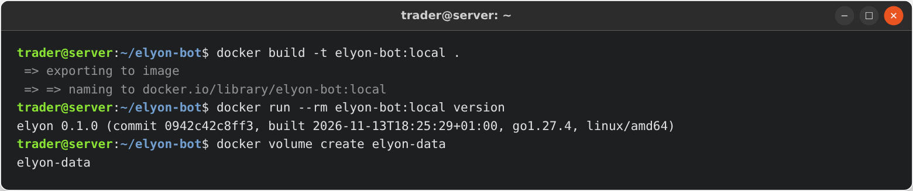
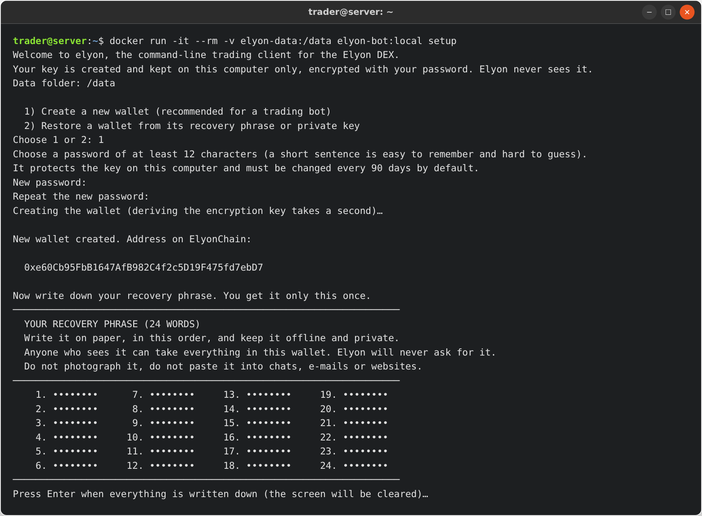
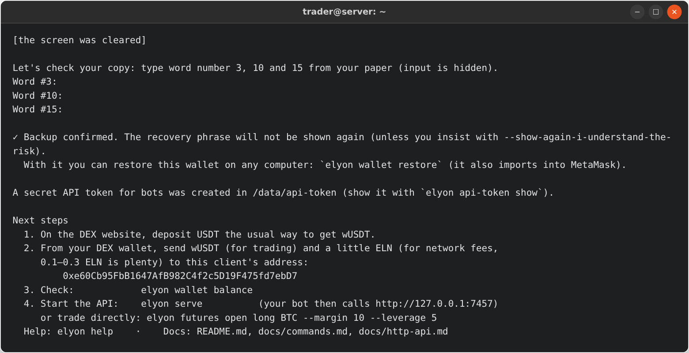
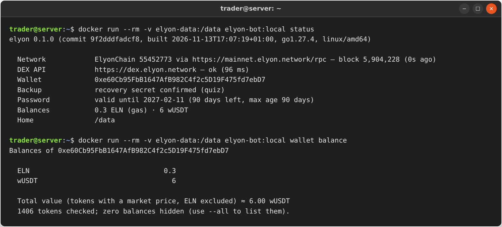
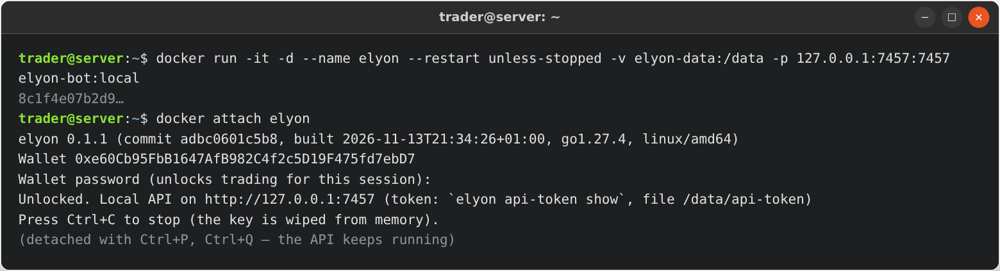
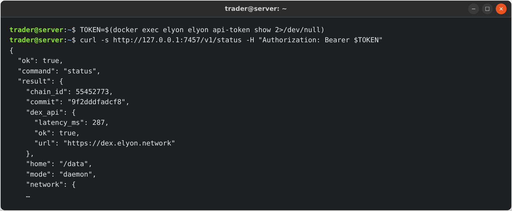
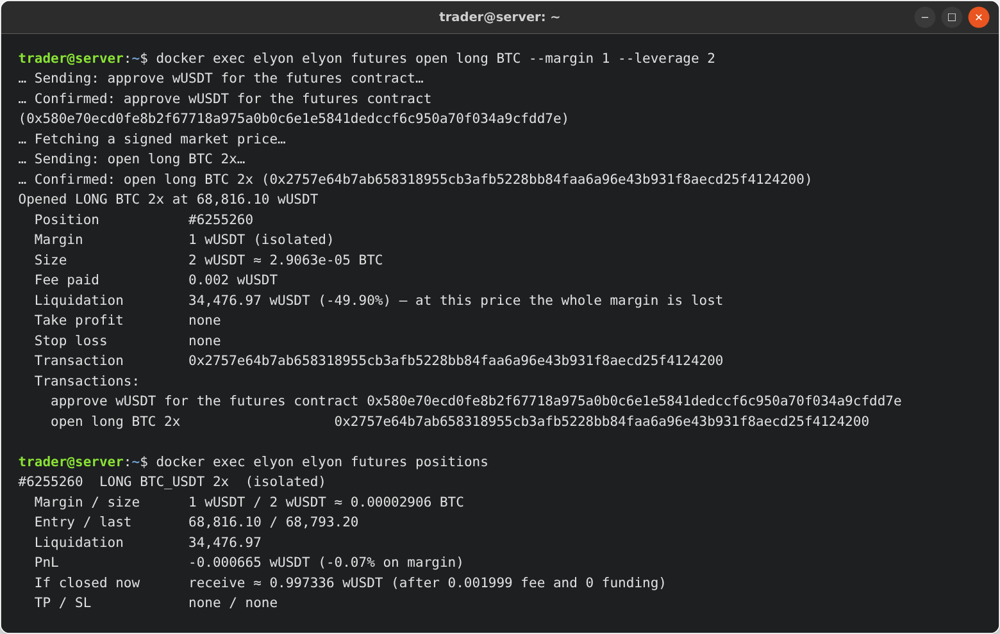

# Run elyon with Docker

The image runs elyon as an unprivileged user (uid 10001) and keeps all data (encrypted wallet, API token,
audit log) in the volume mounted at `/data`.

## 1. Build the image

```sh
git clone https://github.com/ElyonNetwork/elyon-validator-node && cd elyon-validator-node/elyon-bot
docker build -t elyon-bot:local .
docker run --rm elyon-bot:local version
```

No git? Download `elyon-bot-0.1.0-source.tar.gz` from the [download table](https://dex.elyon.network/bots#download),
check it against `SHA256SUMS`, unpack it (`tar xzf elyon-bot-0.1.0-source.tar.gz && cd elyon-bot-0.1.0`) and run the same
`docker build`.



## 2. Create the wallet (interactive, once)

```sh
docker volume create elyon-data
docker run -it --rm -v elyon-data:/data elyon-bot:local setup
```
Choose **1**, a password, and **write the 24 words on paper**. Show the address any time with
`docker run --rm -v elyon-data:/data elyon-bot:local wallet address`, and send wUSDT and 0.1–0.3 ELN to it.







## 3. Start the API

### Option A — type the password once (most secure)

```sh
docker run -it -d --name elyon --restart unless-stopped \
  -v elyon-data:/data -p 127.0.0.1:7457:7457 elyon-bot:local
docker attach elyon        # type the password, then detach with Ctrl+P then Ctrl+Q
```
After a restart of the container you must attach and type the password again (`elyon` stays locked until
then — this is the point).



### Option B — unattended, with a Docker secret

Read [SECURITY.md](../SECURITY.md#unattended-mode): whoever can read the secret can unlock the wallet.

```sh
printf '%s' 'your password' > elyon_password.txt && chmod 600 elyon_password.txt
docker run -d --name elyon --restart unless-stopped \
  -v elyon-data:/data -p 127.0.0.1:7457:7457 \
  -v "$PWD/elyon_password.txt:/run/secrets/elyon_password:ro" \
  -e ELYON_PASSWORD_FILE=/run/secrets/elyon_password \
  elyon-bot:local serve --auto-lock 12h
```

`docker-compose.yml`:
```yaml
services:
  elyon:
    image: elyon-bot:local
    command: ["serve", "--auto-lock", "12h"]
    restart: unless-stopped
    ports: ["127.0.0.1:7457:7457"]
    volumes: ["elyon-data:/data"]
    environment:
      ELYON_PASSWORD_FILE: /run/secrets/elyon_password
    secrets: [elyon_password]
  # your bot, on the same compose network, calls http://elyon:7457 with the token from
  # `docker compose exec elyon elyon api-token show` (pass it to the bot as a secret, not in this file):
  # bot:
  #   image: my-bot
  #   environment:
  #     ELYON_URL: http://elyon:7457
volumes:
  elyon-data:
secrets:
  elyon_password:
    file: ./elyon_password.txt
```

## 4. Connect your bot

```sh
TOKEN=$(docker exec elyon elyon api-token show 2>/dev/null)
curl -s http://127.0.0.1:7457/v1/status -H "Authorization: Bearer $TOKEN"
```





Network rules built into the image:

- inside the container the API listens on `0.0.0.0:7457`, but only clients from private networks are
  accepted (`ELYON_ALLOW_IP=127.0.0.1,10.0.0.0/8,172.16.0.0/12,192.168.0.0/16`): the host through the
  published port, and other containers. Narrow it (for example `-e ELYON_ALLOW_IP=172.18.0.0/16`) or set
  `--allow-ip` on the command line;
- publish the port **only on the host's loopback** (`-p 127.0.0.1:7457:7457`), never `-p 7457:7457` on a
  machine reachable from the internet;
- the bearer token is still required for every request.

Run any command inside the container: `docker exec elyon elyon futures positions`. Commands that sign are
sent to the running API automatically.

## Health, logs, backup

- Health check: `GET /v1/health` (built into the image; `docker ps` shows `healthy`).
- Logs: `docker logs -f elyon` (one line per request, no secrets). Audit log:
  `docker exec elyon cat /data/audit.log`.
- Back up the **24 words on paper**. The volume holds only the encrypted wallet; a copy of it is useless
  without the password, and the words alone are enough to restore anywhere.
