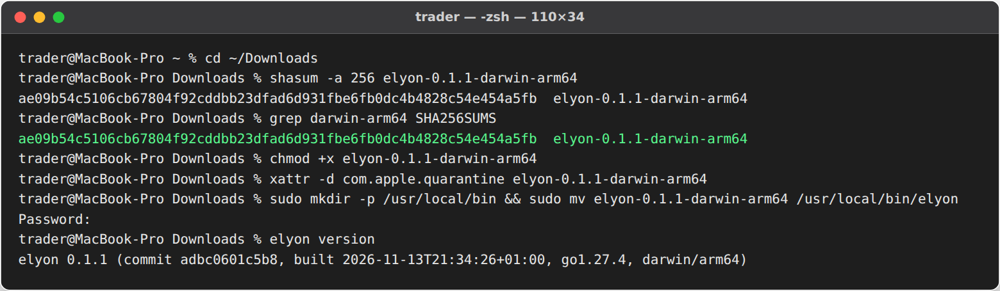
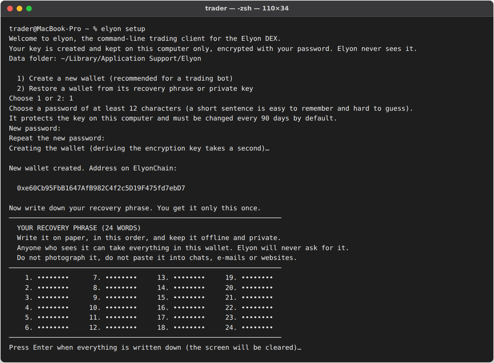
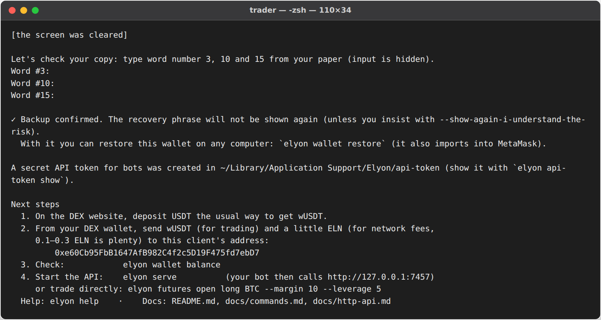
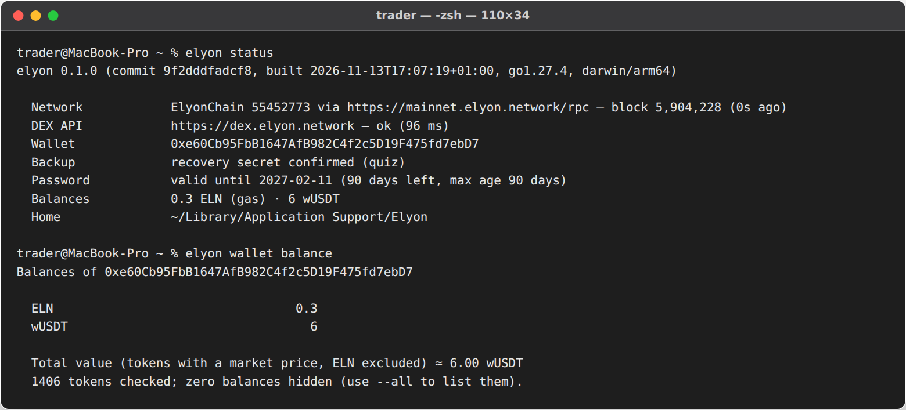
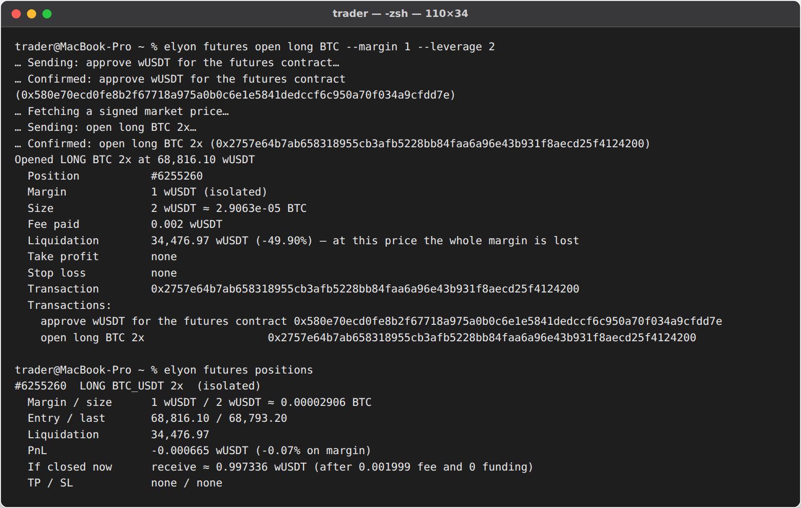
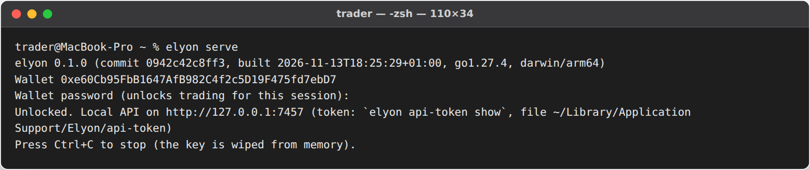
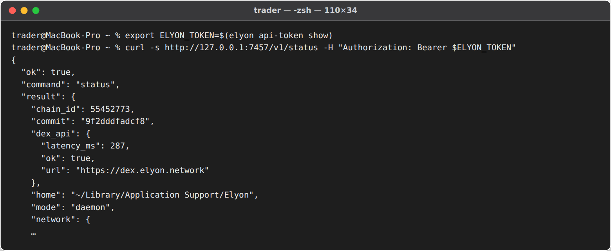

# Install elyon on macOS

Works on macOS 12 or newer, Apple Silicon (M1–M4) and Intel.

## 1. Download

Which file? Apple menu → **About This Mac**: "Chip Apple M…" → `elyon-0.1.1-darwin-arm64`;
"Processor Intel" → `elyon-0.1.1-darwin-amd64`. Download it and `SHA256SUMS`, then open **Terminal**
(Applications → Utilities) and check the file:
```sh
cd ~/Downloads
shasum -a 256 elyon-0.1.1-darwin-arm64      # use the name of your file
grep darwin SHA256SUMS
```
Both hashes must be identical.

## 2. Install

```sh
chmod +x elyon-0.1.1-darwin-arm64
xattr -d com.apple.quarantine elyon-0.1.1-darwin-arm64   # allow a downloaded command-line program to run
sudo mkdir -p /usr/local/bin
sudo mv elyon-0.1.1-darwin-arm64 /usr/local/bin/elyon
elyon version
```
(Without `sudo`: move it to `~/bin` and add `export PATH="$HOME/bin:$PATH"` to `~/.zshrc`.)



## 3. Create your wallet

```sh
elyon setup
```
Choose **1**, set a password of 12+ characters, and **write the 24 words on paper** (shown once, then a
3-word check). Data folder: `~/Library/Application Support/Elyon` (only your user can read it).





## 4. Fund it

```sh
elyon wallet address
```
Send **wUSDT** and **0.1–0.3 ELN** from your DEX wallet to this address, then `elyon wallet balance`.



## 5. Trade or run the API

```sh
elyon futures open long BTC --margin 10 --leverage 5 --stop-loss 62000
elyon serve                   # API for bots on http://127.0.0.1:7457 (password asked once)
elyon api-token show          # in another Terminal tab: the token for your bot
```







### Keep the API running in the background (optional)

Interactive: start `elyon serve` inside `tmux` or `screen` and detach. Unattended (reads the password from a
file — see [SECURITY.md](../SECURITY.md#unattended-mode)): create `~/Library/LaunchAgents/network.elyon.serve.plist`:
```xml
<?xml version="1.0" encoding="UTF-8"?>
<!DOCTYPE plist PUBLIC "-//Apple//DTD PLIST 1.0//EN" "http://www.apple.com/DTDs/PropertyList-1.0.dtd">
<plist version="1.0"><dict>
  <key>Label</key><string>network.elyon.serve</string>
  <key>ProgramArguments</key><array><string>/usr/local/bin/elyon</string><string>serve</string><string>--auto-lock</string><string>12h</string></array>
  <key>EnvironmentVariables</key><dict><key>ELYON_PASSWORD_FILE</key><string>/Users/YOU/.elyon-password</string></dict>
  <key>RunAtLoad</key><true/><key>KeepAlive</key><true/>
  <key>StandardErrorPath</key><string>/Users/YOU/Library/Logs/elyon.log</string>
</dict></plist>
```
```sh
printf '%s' 'your password' > ~/.elyon-password && chmod 600 ~/.elyon-password
launchctl load ~/Library/LaunchAgents/network.elyon.serve.plist
```

## Update / uninstall

Replace `/usr/local/bin/elyon` with the new version (the wallet stays in Application Support). To remove:
withdraw funds, delete the binary, and only with your 24 words on paper delete
`~/Library/Application Support/Elyon`.
