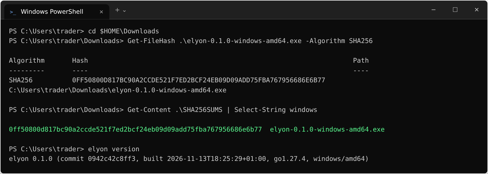
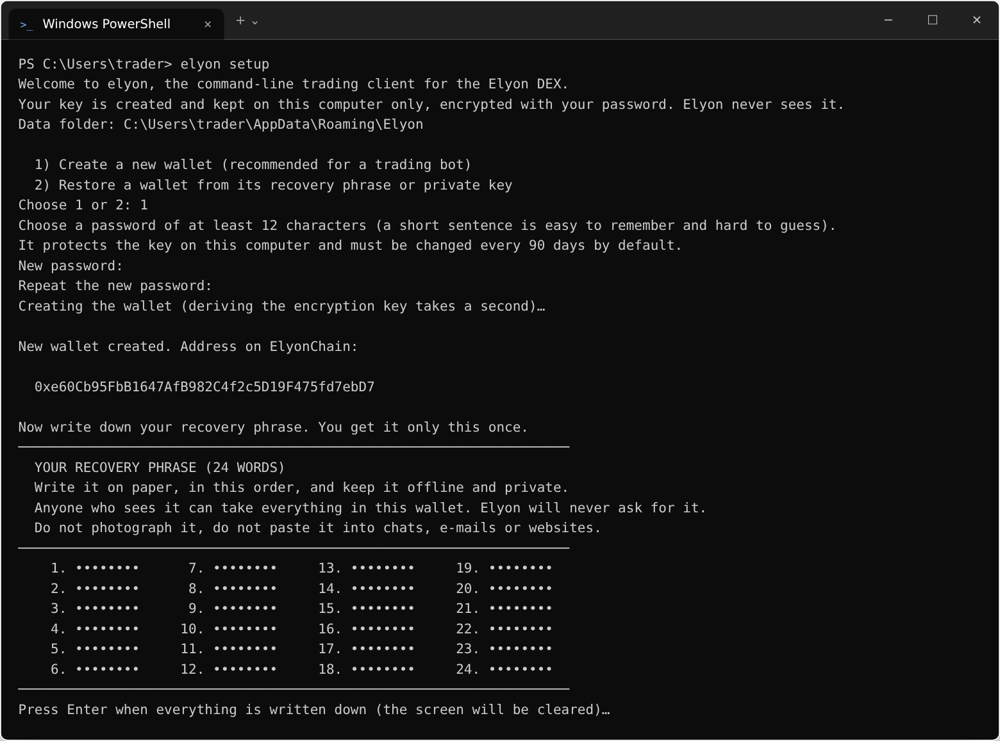
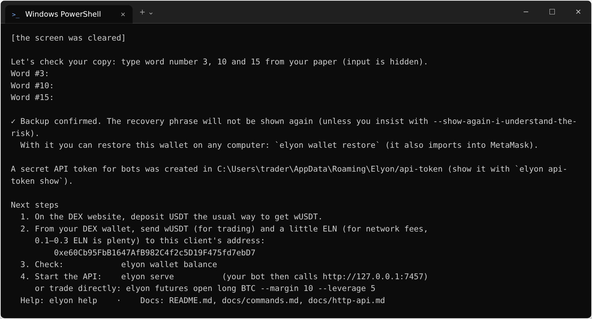
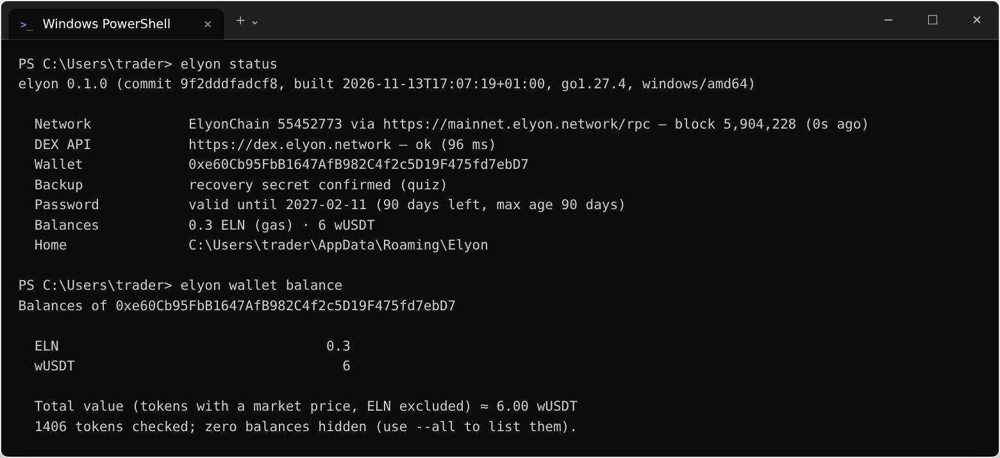
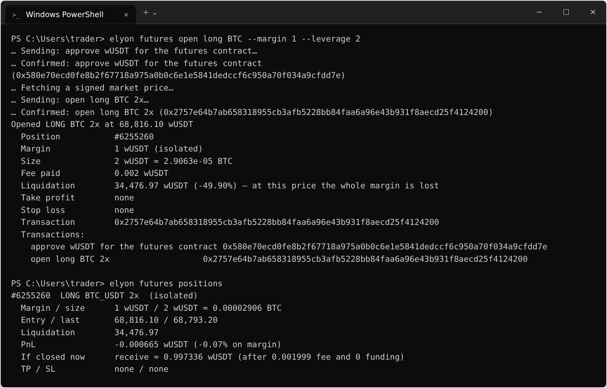
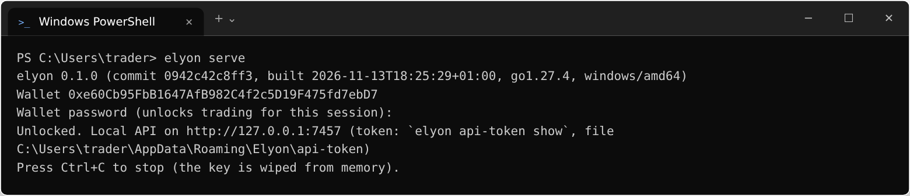
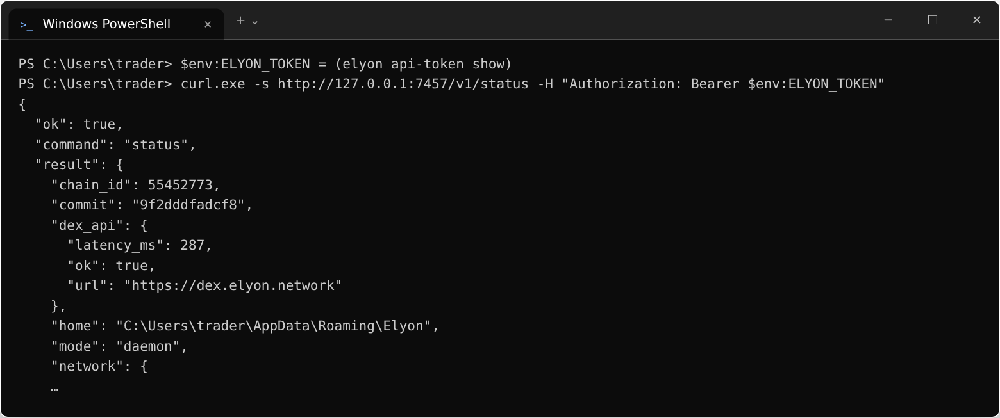

# Install elyon on Windows

Works on Windows 10 and 11 (64-bit). No installer, no administrator rights: elyon is a single program.

## 1. Download

1. Download `elyon-0.1.1-windows-amd64.exe` and `SHA256SUMS` from the release page.
2. Check that the file is genuine. Open **PowerShell** (Start menu → type `PowerShell`) in your Downloads
   folder and run:
   ```powershell
   cd $HOME\Downloads
   Get-FileHash .\elyon-0.1.1-windows-amd64.exe -Algorithm SHA256
   Get-Content .\SHA256SUMS
   ```
   The long hash shown by `Get-FileHash` must be **exactly** the one written next to the file name in
   `SHA256SUMS`. If it is different, delete the file and download it again.

## 2. Put it in place

```powershell
New-Item -ItemType Directory -Force $HOME\elyon | Out-Null
Move-Item .\elyon-0.1.1-windows-amd64.exe $HOME\elyon\elyon.exe
# make "elyon" available in every new PowerShell window:
[Environment]::SetEnvironmentVariable("Path", $env:Path + ";$HOME\elyon", "User")
```
Close PowerShell and open a new one. Check:
```powershell
elyon version
```
If Windows SmartScreen warns about an unknown publisher, click **More info → Run anyway** (the program is
open source; you verified its checksum above).



## 3. Create your wallet

```powershell
elyon setup
```
Choose **1** (new wallet), choose a password (12+ characters — a short sentence works well), and **write the
24 words on paper**. They are shown only once; the screen is cleared and you are asked for three of them.

Your data is stored in `%APPDATA%\Elyon` (for example `C:\Users\you\AppData\Roaming\Elyon`). This folder
belongs to your Windows user: other users of the computer cannot open it. Do not move it to a shared or
cloud-synced folder.





## 4. Fund it

```powershell
elyon wallet address
```
On the DEX website, send **wUSDT** (for trading) and **0.1–0.3 ELN** (for network fees) from your DEX
wallet to this address. Then:
```powershell
elyon wallet balance
```



## 5. Trade or start the API for your bot

Trade directly:
```powershell
elyon futures price BTC
elyon futures open long BTC --margin 10 --leverage 5 --stop-loss 62000
elyon futures positions
```



Or start the local API (keep this window open; the password is asked once):
```powershell
elyon serve
```


In another window, get the token for your bot:
```powershell
elyon api-token show
```
Your bot calls `http://127.0.0.1:7457` with the header `Authorization: Bearer <token>`. A PowerShell
example is in `examples\powershell\bot.ps1`:
```powershell
$env:ELYON_TOKEN = (elyon api-token show)
.\bot.ps1
```



### Start the API automatically (optional)

Only if the computer must restart unattended. This stores the password in a file — read
[SECURITY.md](../SECURITY.md#unattended-mode) first.
```powershell
Set-Content -NoNewline -Path $env:APPDATA\Elyon\password.txt -Value "your password"
icacls $env:APPDATA\Elyon\password.txt /inheritance:r /grant:r "$($env:USERNAME):(R,W)"
$action = New-ScheduledTaskAction -Execute "$HOME\elyon\elyon.exe" -Argument "serve --auto-lock 12h"
$trigger = New-ScheduledTaskTrigger -AtLogOn
Register-ScheduledTask -TaskName "elyon" -Action $action -Trigger $trigger
[Environment]::SetEnvironmentVariable("ELYON_PASSWORD_FILE", "$env:APPDATA\Elyon\password.txt", "User")
```

## Update

Download the new version, verify its checksum, and replace `elyon.exe`. Your wallet in `%APPDATA%\Elyon`
is kept.

## Uninstall

Withdraw your funds first (`elyon wallet send all wUSDT to <your address>`, then ELN). Then delete
`%USERPROFILE%\elyon` and, only if you have your 24 words on paper, `%APPDATA%\Elyon`.
